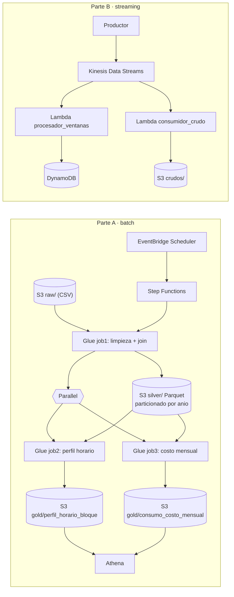

# Informe del Trabajo 2 — Pipeline batch y streaming en AWS

**Universidad EAFIT · Maestría en Ciencias de los Datos y Analítica**
**SI7006 Almacenamiento y Procesamiento de Grandes Datos · 2026-2 · Profesor: Edwin Montoya**

| | |
|---|---|
| **Integrantes** |Marcela Londoño Leon, Isabela Osorio Botero, Zarith Isabella Restrepo Giraldo |
| **Repositorio** | https://github.com/zarithrestrepo/trabajo2_Grupo4  |
| **Video** |https://www.youtube.com/watch?v=lW53D0dddhY |
| **Región de AWS usada** | `us-east-1`|

Este informe explica qué se construyó, por qué se diseñó así y, sobre todo, cómo un tercero puede reproducirlo
paso a paso en su propia cuenta de AWS. Las cifras de la Parte A se verificaron dos veces: en Glue/Athena y con el
script local [`extras/validacion_local_pyspark.py`](extras/validacion_local_pyspark.py).

---

## Contenido

1. [Breve descripción de la actividad](#1-breve-descripción-de-la-actividad)
2. [Diseño de alto nivel y decisiones](#2-diseño-de-alto-nivel-y-decisiones)
3. [Ambiente de desarrollo y datos](#3-ambiente-de-desarrollo-y-datos)
4. [Antes de empezar: parámetros y prerrequisitos](#4-antes-de-empezar-parámetros-y-prerrequisitos)
5. [Reproducción de la Parte A (batch)](#5-reproducción-de-la-parte-a-batch)
6. [Reproducción de la Parte B (streaming)](#6-reproducción-de-la-parte-b-streaming)
7. [Resultados](#7-resultados)
8. [Problemas comunes y limpieza de recursos](#8-problemas-comunes-y-limpieza-de-recursos)
9. [Declaración de uso de inteligencia artificial](#9-declaración-de-uso-de-inteligencia-artificial)
10. [Referencias](#10-referencias)

---

## 1. Breve descripción de la actividad

El proyecto integrador estudia el consumo horario de energía activa (kWh) de 120 medidores que dependen de 9
bloques/subestaciones de un campus. Con esos datos se construyeron:

- **Parte A:** un pipeline batch con AWS Glue (PySpark), orquestado por Step Functions e iniciado por un horario de
  EventBridge Scheduler, que limpia, une, particiona y resume los datos para responder dos preguntas de analítica.
- **Parte B:** un flujo de streaming con Kinesis Data Streams, dos consumidores Lambda, DynamoDB y S3, que calcula
  ventanas de un minuto y demuestra que los conteos cuadran.

### 1.1 Aspectos cumplidos

| Requisito del enunciado | Cómo se cumple | Archivo / evidencia |
|---|---|---|
| ≥ 5.000.000 registros (CSV) + segundo conjunto para el join | 5.274.657 lecturas de consumo + 120 medidores | `datos/` |
| Horario de EventBridge Scheduler que inicia la máquina | Horario con destino `StartExecution` de Step Functions | Paso 5.6 |
| Glue inicial que lee CSV de S3, limpia, une y escribe Parquet particionado | Descarta vacíos, negativos, duplicados y atípicos; join por `medidor`; partición por `anio` | `parte_a_batch/glue/job1_limpieza_join.py` |
| Dos ramas en paralelo, automáticas, tras el éxito del Glue inicial | Estado `Parallel` con dos tareas `glue:startJobRun.sync` | `parte_a_batch/step_functions/maquina_de_estados.json` |
| Cada rama responde una pregunta distinta y escribe Parquet | Rama 1: perfil horario. Rama 2: consumo y costo mensual | `job2_rama1_perfil_horario.py`, `job3_rama2_costo_mensual.py` |
| Consulta de las dos agrupaciones | Athena | `parte_a_batch/athena/athena_consultas.sql` |
| Productor continuo ≥ 5 min, con repetidos e inválidos | _ver nota en 1.2_ | `parte_b_streaming/productor.py` |
| Ventanas de 1 minuto: conteo y promedio por categoría | Lambda; categoría = bloque; ventana = minuto del campo `ts` | `lambda_procesador_ventanas.py` |
| Repetidos no se cuentan dos veces | `put_item` condicional sobre `event_id` en `eventos_vistos` | ídem |
| Inválidos apartados con su motivo | Tabla `eventos_invalidos` con atributo `motivo` | ídem |
| Resultado de cada ventana en DynamoDB y consulta | Tabla `ventanas_resultados` + script de consulta | `conteos_y_consultas.py` |
| Segundo consumidor que guarda crudos en S3 | Lambda que escribe JSON lines en `crudos/aaaa/mm/dd/hh/` | `lambda_consumidor_crudo.py` |
| Conteos que cuadran | publicados = únicos + repetidos + inválidos (= crudos en S3) | `conteos_y_consultas.py` |
| Recursos creados a mano, sin IaC | Todo por consola; CloudFormation sin stacks | Video |

### 1.2 Aspectos no cumplidos o pendientes

- _Agregar `parte_b_streaming/productor.py` (el programa que publica en Kinesis) y el `resumen_productor.json` de una
  ejecución. Sin él no se puede reproducir la Parte B._
- _Completar los números de la Parte B en la sección 7.2 con la salida real de `conteos_y_consultas.py`._
- _Si algo no se cumplió, decirlo aquí._

---

## 2. Diseño de alto nivel y decisiones

### 2.1 Arquitectura



Los datos siguen el modelo por capas visto en clase: **raw** (CSV tal como llega) → **silver** (limpio, unido y en
Parquet) → **gold** (agregaciones listas para responder preguntas).

### 2.2 Decisiones de diseño (y por qué)

**Parte A**

| Decisión | Por qué |
|---|---|
| Esquemas explícitos al leer el CSV | El encabezado trae BOM y tildes (`Hora del día`, `Energía activa (kWh)`). Con un esquema fijo las columnas se asignan por posición y quedan con nombres limpios. Además, un valor que no se puede convertir (por ejemplo texto en `kwh`) queda como nulo y lo elimina la regla de vacíos. |
| Cuatro reglas de limpieza en orden: vacíos → negativos → duplicados → atípicos | Cada regla se cuenta por separado y queda en el log de Glue (`[LIMPIEZA] `), lo que permite explicar en el video cuántos registros quitó cada una. |
| Duplicado = misma terna `(medidor, fecha, hora)` | Un medidor solo puede tener una lectura por hora. |
| Atípico = kWh > 3 × percentil 99 del propio medidor | Los medidores tienen escalas muy distintas (el bloque 40 consume ~6 veces más que el 1G); un umbral global borraría lecturas normales de los medidores grandes. |
| `broadcast` en el join con `medidores` | La tabla de medidores tiene 120 filas: se copia a cada ejecutor y se evita mover millones de filas por la red (shuffle). |
| **Partición por `año`** | Las consultas de la rama 2 filtran por año (2022–2025 son los años completos), así que Athena solo lee las particiones necesarias. Son 6 particiones de ~1 millón de filas, un tamaño sano. Particionar por `medidor` (120) o por `fecha` (1.826 días) crearía miles de archivos pequeños, que hacen más lentas las consultas. |
| `dia_semana` con 1 = lunes … 7 = domingo | Spark numera 1 = domingo; se ajusta con `(dayofweek + 5) % 7 + 1` para que la lectura sea natural. |
| Variación interanual sobre kWh promedio por día | Octubre de 2021 y octubre de 2026 están incompletos. Comparar totales mensuales daría variaciones falsas; el promedio diario sí es comparable. |
| Costo = kWh × 512 COP/kWh | Supuesto de tarifa de energía comprada a la red tomado de la propuesta del proyecto. |
| `Retry` (1 reintento) y `Catch` → `Fail` en cada tarea | Un fallo transitorio de Glue se reintenta una vez; si vuelve a fallar, la ejecución termina en un estado de error con causa legible. |

**Parte B**

| Decisión | Por qué |
|---|---|
| Lambda en lugar de Managed Flink | El enunciado lo permite. Es más sencillo de crear a mano en la consola y de explicar. |
| Ventana = minuto del campo `ts` del evento (UTC) | Se agrupa por la hora en que ocurrió el evento, no por la hora en que llegó. |
| Repetido = mismo `event_id` | `put_item` con `ConditionExpression="attribute_not_exists(event_id)"` sobre `eventos_vistos`: solo la primera escritura gana; las siguientes fallan y se registran como repetidas. |
| Reintentos de Lambda sin doble conteo | Si Lambda reprocesa un lote, el mismo registro de Kinesis trae el mismo `sequenceNumber`. El código compara ese número con el guardado: si coincide, es un reintento y no se cuenta. Las tablas de repetidos e inválidos usan `seq` como llave, así que reescribirlas no crea filas nuevas. |
| Conteos a partir de tablas, no de contadores | Contar ítems de tablas con llave única es idempotente y verificable desde afuera; un contador en memoria se pierde o se duplica con reintentos. |
| Rango válido de kWh = [0, 1500] | Configurable con las variables `KWH_MIN` y `KWH_MAX`. |
| Segundo consumidor independiente | Lee el mismo stream con su propio disparador y guarda todo tal como llega, incluso repetidos e inválidos. Sirve de segunda comprobación del cuadre. |

---

## 3. Ambiente de desarrollo y datos

### 3.1 Tecnologías y versiones

| Componente | Versión / configuración |
|---|---|
| AWS Glue | _Glue 4.0 (Spark 3.3, Python 3.10), tipo Spark, workers G.1X — ajustar a lo usado_ |
| AWS Step Functions | Tipo Standard (el patrón `.sync` no funciona en Express) |
| AWS Lambda | _Python 3.12 — ajustar_ |
| Python local / CloudShell | Python 3.10+ con `boto3` |
| Validación local (opcional) | Java 11+ y `pyspark==3.5.3` |

### 3.2 Datos

**`consumo_sintetico_subestaciones.csv`** — 5.274.657 filas, del 23-oct-2021 al 22-oct-2026, una lectura por
medidor y hora. Es un conjunto sintético del proyecto integrador, ampliado para superar el mínimo de 5 millones de
registros. Trae errores a propósito (vacíos, negativos, duplicados y picos) para que la limpieza tenga trabajo real.

| Columna original | Nombre en el pipeline | Tipo |
|---|---|---|
| Medidor | `medidor` | string (SUB-001 … SUB-120) |
| Fecha | `fecha` | date |
| Hora del día | `hora` | int (0–23) |
| Energía activa (kWh) | `kwh` | double |

En el repositorio va comprimido (`.csv.gz`, ~44 MB) porque el CSV original pesa ~146 MB y GitHub no acepta archivos
de más de 100 MB.

**`medidores.csv`** — 120 filas: `Medidor, Subestacion_origen, Bloque_origen, Capacidad_kVA_origen,
Nivel_tension_kV, Bloques_atendidos, Escala, Intensidad_pico, Tendencia_anual`. La columna común para el join es
`Medidor`. Hay 9 bloques: 03, 13, 18, 19, 1G, 20, 30, 32 y 40.

**Eventos de la Parte B** — JSON con los campos `event_id`, `bloque`, `kwh` y `ts`, por ejemplo:

```json
{"event_id": "4f9c2e1a-...", "bloque": "18", "kwh": 142.7, "ts": "2026-11-04T15:03:27Z"}
```

---

## 4. Antes de empezar: parámetros y prerrequisitos

### 4.1 Prerrequisitos

- Cuenta de AWS (por ejemplo AWS Academy Learner Lab) con acceso a S3, Glue, Step Functions, EventBridge Scheduler,
  Athena, Kinesis, Lambda, DynamoDB e IAM.
- **Rol de IAM.** En AWS Academy no se pueden crear roles: se usa `LabRole` en todos los servicios. En una cuenta
  normal se crean roles con los permisos indicados en cada paso.
- AWS CloudShell (recomendado, ya trae Python y boto3) o un PC con AWS CLI configurada.
- **CloudFormation sin stacks** en la región de trabajo. Si quedan stacks de laboratorios anteriores, borrarlos antes
  de grabar el video (condición eliminatoria 7.1).

### 4.2 Nombres usados en esta guía

Reemplace los valores entre `< >` por los suyos. Los nombres de los trabajos de Glue y de las tablas de
DynamoDB deben ser exactamente estos, porque están escritos en el código y en la máquina de estados.

| Recurso | Nombre |
|---|---|
| Bucket S3 | `<BUCKET>` (por ejemplo `trabajo2-grupoX-2026`) |
| Base de datos de Athena | `trabajo2` |
| Trabajos de Glue | `job1-limpieza-join`, `job2-rama1-perfil-horario`, `job3-rama2-costo-mensual` |
| Máquina de estados | `<MAQUINA>` (por ejemplo `trabajo2-pipeline-batch`) |
| Horario | `<HORARIO>` (por ejemplo `trabajo2-horario`) |
| Stream de Kinesis | `<STREAM>` (por ejemplo `trabajo2-consumo`) |
| Tablas de DynamoDB | `eventos_vistos`, `eventos_repetidos`, `eventos_invalidos`, `ventanas_resultados` |
| Lambdas | `procesador-ventanas`, `consumidor-crudo` |

### 4.3 Organización del bucket

```
s3://<BUCKET>/
├── raw/consumo/consumo_sintetico_subestaciones.csv   ← entrada del job 1
├── raw/medidores/medidores.csv                       ← entrada del job 1 (join)
├── scripts/                                          ← scripts de Glue
├── silver/consumo_enriquecido/anio=2021/ … anio=2026/ ← salida del job 1
├── gold/perfil_horario_bloque/                       ← salida de la rama 1
├── gold/consumo_costo_mensual/                       ← salida de la rama 2
├── athena-resultados/                                ← resultados de Athena
└── crudos/aaaa/mm/dd/hh/*.jsonl                      ← consumidor crudo (Parte B)
```

> **Por qué una carpeta por archivo de entrada:** Spark lee todos los archivos de la carpeta que se le indica. Si
> consumo y medidores estuvieran juntos, el job leería los dos como si fueran consumo.

---

## 5. Reproducción de la Parte A (batch)

### 5.1 Crear el bucket y subir los datos

1. **S3 → Create bucket** → nombre `<BUCKET>`, en la región de trabajo; lo demás por defecto.
2. Descomprimir el consumo en su PC: `gunzip -k datos/consumo_sintetico_subestaciones.csv.gz`.
   (Spark también lee `.csv.gz` directamente; puede subir el comprimido si su conexión es lenta.)
3. Subir `consumo_sintetico_subestaciones.csv` a `raw/consumo/` y `medidores.csv` a `raw/medidores/`.
   Desde CloudShell, con los archivos ya cargados (**Actions → Upload file**):
   ```bash
   aws s3 cp consumo_sintetico_subestaciones.csv s3://<BUCKET>/raw/consumo/
   aws s3 cp medidores.csv s3://<BUCKET>/raw/medidores/
   ```

### 5.2 Configurar Athena

**Athena → Query editor → Settings → Manage → Query result location** = `s3://<BUCKET>/athena-resultados/`.
Sin esto Athena no deja ejecutar consultas.

### 5.3 Crear los tres trabajos de Glue

Para cada script de `parte_a_batch/glue/`:

1. **AWS Glue → ETL jobs → Script editor** → motor **Spark** → **Upload script** → elegir el `.py`.
2. Pestaña **Job details**:
   - **Name:** exactamente el de la tabla siguiente.
   - **IAM Role:** `LabRole` (o un rol con `AWSGlueServiceRole` y lectura/escritura en el bucket).
   - **Glue version:** _4.0_ · **Worker type:** G.1X · **Number of workers:** _2–5 (ajustar)_.
   - **Advanced properties → Job parameters:** agregar los parámetros de la tabla.
3. **Save.**

| Job | Script | Parámetros (Key → Value) |
|---|---|---|
| `job1-limpieza-join` | `job1_limpieza_join.py` | `--consumo_path` → `s3://<BUCKET>/raw/consumo/`<br/>`--medidores_path` → `s3://<BUCKET>/raw/medidores/`<br/>`--output_path` → `s3://<BUCKET>/silver/consumo_enriquecido/` |
| `job2-rama1-perfil-horario` | `job2_rama1_perfil_horario.py` | `--input_path` → `s3://<BUCKET>/silver/consumo_enriquecido/`<br/>`--output_path` → `s3://<BUCKET>/gold/perfil_horario_bloque/` |
| `job3-rama2-costo-mensual` | `job3_rama2_costo_mensual.py` | `--input_path` → `s3://<BUCKET>/silver/consumo_enriquecido/`<br/>`--output_path` → `s3://<BUCKET>/gold/consumo_costo_mensual/` |

> **Por qué los parámetros van en el job:** la máquina de estados solo envía `JobName`, sin argumentos. Glue usa
> entonces los parámetros por defecto guardados en cada job. Si faltan, el job falla con
> `GlueArgumentError: the following arguments are required`.

(Opcional) Ejecutar `job1-limpieza-join` una vez con **Run** para probarlo. En **Runs → Output logs** deben verse
las líneas `[LIMPIEZA]` y `[JOIN]` con los valores de la sección 7.1.

### 5.4 Crear la máquina de estados

1. **Step Functions → State machines → Create state machine** → **Blank** → tipo **Standard**.
2. Pestaña **Code** → borrar el contenido y pegar `parte_a_batch/step_functions/maquina_de_estados.json`.
   La pestaña **Design** debe mostrar: `GlueInicial_LimpiezaJoin` → `RamasEnParalelo` (con `Rama1_PerfilHorario` y
   `Rama2_CostoMensual`), más los estados `Fail`.
3. **Config:** nombre `<MAQUINA>`; **Execution role:** `LabRole`, o dejar que la consola cree uno (debe permitir
   `glue:StartJobRun`, `glue:GetJobRun`, `glue:GetJobRuns` y `glue:BatchStopJobRun`).
4. **Create.**

> **Qué hace `.sync`:** `arn:aws:states:::glue:startJobRun.sync` inicia el job y **espera a que termine**. Por eso
> las ramas solo arrancan cuando el job 1 acaba con éxito, y las dos arrancan a la vez porque están dentro del
> estado `Parallel`.

### 5.5 Prueba manual (opcional)

**Start execution** con entrada `{}`. Debe terminar en verde (**Succeeded**) en unos 5–10 minutos. Si algo falla,
la pestaña **Events** muestra el error de Glue.

### 5.6 Crear el horario de EventBridge Scheduler

1. **Amazon EventBridge → Scheduler → Schedules → Create schedule.**
2. **Name:** `<HORARIO>` · **Schedule pattern:** **One-time schedule**, con fecha y hora unos 5 minutos en el futuro
   (o **Recurring** con una expresión cron, por ejemplo `cron(0 6 * * ? *)` para todos los días a las 6:00).
   **Timezone:** `America/Bogota` · **Flexible time window:** Off.
3. **Target:** **AWS Step Functions → StartExecution** → elegir `<MAQUINA>` → **Input:** `{}`.
4. **Permissions:** `LabRole`, o un rol nuevo que permita `states:StartExecution` sobre la máquina.
5. **Create schedule.**

### 5.7 Verificar la ejecución iniciada por el horario

1. A la hora programada aparece una nueva ejecución en **Step Functions → `<MAQUINA>` → Executions**, con hora de
   inicio igual a la del horario. Esa es la evidencia de que la inició el horario y no una persona.
2. En **Graph view** los tres jobs deben quedar en verde y las dos ramas deben haber corrido al mismo tiempo.
3. En S3 deben existir:
   - `silver/consumo_enriquecido/anio=2021/` … `anio=2026/` (6 carpetas con archivos `.parquet`).
   - `gold/perfil_horario_bloque/` y `gold/consumo_costo_mensual/` (un archivo `.parquet` cada uno).

### 5.8 Consultar con Athena

Abrir `parte_a_batch/athena/athena_consultas.sql`, reemplazar `TU-BUCKET` por `<BUCKET>` y ejecutar **una consulta a
la vez, en orden**:

| Paso | Consulta | Resultado esperado |
|---|---|---|
| 1 | `CREATE DATABASE trabajo2` | Luego elegir `trabajo2` en el panel izquierdo |
| 2–3 | Tabla `consumo_enriquecido` + `MSCK REPAIR TABLE` | `MSCK` registra las 6 particiones; sin él la tabla aparece vacía |
| 4 | Filas por año | 6 filas que suman **5.230.220** |
| 5–6 | **Pregunta 1** (rama 1) | 9 filas, una por bloque, con su hora y día pico |
| 7 | Perfil de 24 horas del bloque 20 un miércoles | 24 filas |
| 8–9 | **Pregunta 2** (rama 2) | 36 filas (9 bloques × 4 años completos) |
| 10 | Detalle mensual del bloque 20 | 61 filas (oct-2021 a oct-2026) |
| 11 | Hallazgo del bloque 18 | Variaciones negativas de abril a octubre de 2025 |

---

## 6. Reproducción de la Parte B (streaming)

> **Orden importante:** crear las tablas, las Lambdas y sus disparadores **antes** de lanzar el productor. Así los
> dos consumidores leen todos los eventos desde el principio y los conteos cuadran.

### 6.1 Crear el stream de Kinesis

**Kinesis → Data streams → Create data stream** → nombre `<STREAM>` → modo **Provisioned, 1 shard** (alcanza para
este volumen) u **On-demand**.

### 6.2 Crear las cuatro tablas de DynamoDB

**DynamoDB → Tables → Create table**, con capacidad **On-demand**:

| Tabla | Partition key | Sort key | Para qué sirve |
|---|---|---|---|
| `eventos_vistos` | `event_id` (String) | — | Un ítem por evento único; base de la deduplicación |
| `eventos_repetidos` | `seq` (String) | — | Repetidos descartados, con el `seq` del original |
| `eventos_invalidos` | `seq` (String) | — | Inválidos descartados, con su `motivo` y el texto recibido |
| `ventanas_resultados` | `categoria` (String) | `ventana_inicio` (String) | Una fila por bloque y minuto: `conteo`, `suma`, `promedio` |

> El código escribe un atributo `ttl` (24 horas) en `eventos_vistos`. **No active TTL en esa tabla** hasta haber
> corrido el cuadre: si DynamoDB borra ítems vencidos, el conteo de únicos baja y el cuadre falla.

### 6.3 Crear la Lambda `procesador-ventanas` (consumidor 1)

1. **Lambda → Create function** → **Author from scratch** → nombre `procesador-ventanas` → runtime **Python 3.12** →
   rol existente `LabRole` (o un rol con `AWSLambdaKinesisExecutionRole` y escritura en las 4 tablas).
2. Pegar el contenido de `parte_b_streaming/lambda_procesador_ventanas.py` en `lambda_function.py` → **Deploy**.
3. **Runtime settings → Edit → Handler:** `lambda_function.handler`.
   (El código define la función `handler`, no `lambda_handler`, que es el valor por defecto de la consola.)
4. **Configuration → General configuration:** timeout **1 min**, memoria 256 MB.
5. (Opcional) **Environment variables:** `KWH_MIN=0`, `KWH_MAX=1500`. Los nombres de tabla tienen valores por defecto.
6. **Add trigger → Kinesis** → `<STREAM>` → **Batch size:** 100 → **Starting position:** **Trim horizon** → **Add**.

### 6.4 Crear la Lambda `consumidor-crudo` (consumidor 2)

Igual que la anterior, con el código de `parte_b_streaming/lambda_consumidor_crudo.py`, handler
`lambda_function.handler`, la variable de entorno **`BUCKET=<BUCKET>`** (sin `s3://`) y su propio disparador de
Kinesis sobre el mismo `<STREAM>`, también con **Trim horizon**.

### 6.5 Ejecutar el productor

_Completar con el comando real del productor del equipo._ El productor debe:

- publicar eventos en `<STREAM>` durante **al menos 5 minutos**;
- reenviar a propósito algunos eventos con el mismo `event_id` (repetidos);
- enviar algunos inválidos: sin un campo, con `kwh` fuera de [0, 1500], con `kwh` no numérico, con `ts` mal
  formado o con texto que no es JSON;
- al terminar, escribir `resumen_productor.json` con al menos `{"publicados": N}`.

```bash
# Ejemplo desde CloudShell (ajustar a los argumentos reales del productor)
python3 productor.py --stream <STREAM> --minutos 6 --region <REGION>
```

Mientras corre, se puede mostrar:

- **Kinesis → `<STREAM>` → Monitoring:** gráfica `Incoming records`.
- **CloudWatch → Log groups → `/aws/lambda/procesador-ventanas`:** líneas
  `lote: unicos=.. repetidos=.. invalidos=.. ventanas=..`.
- **DynamoDB → `ventanas_resultados` → Explore table items:** filas por bloque y minuto.
- **DynamoDB → `eventos_invalidos`:** cada inválido con su `motivo`.
- **S3 → `crudos/`:** archivos `.jsonl`.

### 6.6 Comprobar el cuadre y responder la pregunta

Esperar 1–2 minutos después de que termine el productor (para que las Lambdas procesen los últimos lotes) y correr,
en la misma carpeta donde quedó `resumen_productor.json`:

```bash
python3 parte_b_streaming/conteos_y_consultas.py --bucket <BUCKET> --resumen resumen_productor.json --region <REGION>
```

El script:

1. cuenta los ítems de `eventos_vistos`, `eventos_repetidos` y `eventos_invalidos`;
2. suma los `conteo` de `ventanas_resultados` (debe ser igual a los únicos);
3. cuenta las líneas de todos los archivos de `crudos/` en S3 (segunda comprobación);
4. imprime `RESULTADO: CUADRA` si **publicados = únicos + repetidos + inválidos = crudos** y la suma de las ventanas
   es igual a los únicos;
5. responde la pregunta de la Parte B: **¿qué bloque tuvo el mayor consumo promedio por evento y cuál fue su
   ventana pico?**

---

## 7. Resultados

### 7.1 Parte A

**Limpieza (job 1).** Los mismos valores aparecen en el log de Glue y en la validación local:

| Etapa | Filas eliminadas | Filas restantes |
|---|---:|---:|
| Leídas desde S3 | — | 5.274.657 |
| Vacíos o no convertibles | 21.019 | 5.253.638 |
| kWh negativos | 5.280 | 5.248.358 |
| Duplicados (medidor, fecha, hora) | 15.679 | 5.232.679 |
| Atípicos (> 3 × p99 del medidor) | 2.459 | **5.230.220** |
| Tras el join con medidores | 0 | **5.230.220** |

**Filas por partición (`anio`):**

| 2021* | 2022 | 2023 | 2024 | 2025 | 2026* | Total |
|---:|---:|---:|---:|---:|---:|---:|
| 200.500 | 1.045.440 | 1.045.450 | 1.048.358 | 1.045.546 | 844.926 | 5.230.220 |

\* Años incompletos: los datos van del 23-oct-2021 al 22-oct-2026.

**Pregunta 1 — ¿En qué hora y día de la semana se concentra la demanda de cada bloque?**
(Rama 1: 1.512 filas = 9 bloques × 7 días × 24 horas.)

| Bloque | Día pico | Hora pico | kWh promedio |
|---|---|---:|---:|
| 03 | Jueves | 14:00 | 104,80 |
| 13 | Martes | 18:00 | 91,84 |
| 18 | Miércoles | 12:00 | 142,93 |
| 19 | Martes | 18:00 | 183,33 |
| 1G | Miércoles | 18:00 | 70,49 |
| 20 | Martes | 17:00 | 107,44 |
| 30 | Miércoles | 14:00 | 101,76 |
| 32 | Miércoles | 15:00 | 159,53 |
| 40 | Martes | 07:00 | 442,53 |

*Lectura:* la demanda se concentra a mitad de semana (martes y miércoles; el bloque 03, jueves) y entre las 12:00 y
las 18:00, en línea con la actividad académica. El bloque 40 (canchas norte) es la excepción: su pico es a las 7:00,
posiblemente por iluminación y equipos al inicio de la jornada. Además, es el bloque con mayor demanda horaria
(unas 2,4 veces la del siguiente, el bloque 19).

**Pregunta 2 — ¿Cuánto consume y cuánto cuesta cada bloque por año?**
(Rama 2: 549 filas = 9 bloques × 61 meses. Costo con el supuesto de 512 COP/kWh.)

| Bloque | kWh 2022 | kWh 2023 | kWh 2024 | kWh 2025 | Costo 2025 (millones COP) | Variación 2025 vs 2024* |
|---|---:|---:|---:|---:|---:|---:|
| 40 | 20.890.666 | 21.238.763 | 21.971.856 | 23.083.017 | 11.818,5 | +5,35 % |
| 19 | 13.556.000 | 13.777.307 | 14.059.043 | 14.142.466 | 7.240,9 | +0,87 % |
| 32 | 12.045.745 | 12.032.464 | 12.162.661 | 12.293.676 | 6.294,4 | +1,35 % |
| 18 | 10.463.963 | 11.184.486 | 11.490.133 | 10.202.455 | 5.223,7 | **−10,96 %** |
| 20 | 8.093.008 | 8.154.333 | 8.227.096 | 8.375.449 | 4.288,2 | +2,08 % |
| 30 | 6.714.192 | 6.807.096 | 7.003.018 | 7.151.405 | 3.661,5 | +2,40 % |
| 03 | 6.625.693 | 6.804.589 | 6.947.456 | 7.043.162 | 3.606,1 | +1,66 % |
| 13 | 6.331.135 | 6.337.002 | 6.400.045 | 6.374.547 | 3.263,8 | −0,13 % |
| 1G | 3.331.890 | 3.387.507 | 3.464.437 | 3.586.436 | 1.836,3 | +3,81 % |

\* Variación del kWh promedio por día del año.

*Lectura:* el bloque 40 consume casi una cuarta parte de la energía del campus y su consumo crece cada año (+5,35 %
en 2025), así que es el primer candidato para medidas de eficiencia. **Hallazgo:** el bloque 18 cae ≈11 % en 2025.
La consulta 11 muestra que la caída se concentra entre abril y octubre de 2025 (variaciones mensuales de −14 % a
−23 %), que noviembre y diciembre vuelven a lo normal y que en abril–junio de 2026 el consumo sube más de 50 %. Es
una señal que conviene validar con el área de mantenimiento (por ejemplo, un cierre temporal o una obra).

### 7.2 Parte B

_Completar con la salida de `conteos_y_consultas.py`:_

| Concepto | Cantidad |
|---|---:|
| Publicados (productor) | _N_ |
| Únicos procesados (`eventos_vistos`) | _N_ |
| Suma de `conteo` en `ventanas_resultados` | _N_ |
| Repetidos descartados (`eventos_repetidos`) | _N_ |
| Inválidos descartados (`eventos_invalidos`) | _N_ |
| Únicos + repetidos + inválidos | _N_ |
| Eventos crudos en S3 | _N_ |
| **Resultado** | _CUADRA_ |

**Pregunta B — ¿Qué bloque tuvo el mayor consumo promedio por evento y cuál fue su ventana pico?**
_Pegar la tabla que imprime el script e interpretarla en una o dos frases._

**Motivos de invalidez observados:** _por ejemplo `campo_faltante:kwh`, `kwh_fuera_de_rango[0,1500]`,
`kwh_no_numerico`, `ts_invalido`, `json_invalido`, con su cantidad._

---

## 8. Problemas comunes y limpieza de recursos

### 8.1 Problemas comunes

| Síntoma | Causa probable | Solución |
|---|---|---|
| La tabla `consumo_enriquecido` sale vacía en Athena | No se registraron las particiones | Ejecutar `MSCK REPAIR TABLE trabajo2.consumo_enriquecido;` |
| Glue: `the following arguments are required` | Faltan los parámetros del job | Agregarlos en **Job details → Job parameters** (paso 5.3) |
| Step Functions: `AccessDeniedException` al iniciar Glue | Al rol de la máquina le faltan permisos de Glue | Usar `LabRole` o agregar los permisos del paso 5.4 |
| Athena: `No output location provided` | Falta la ubicación de resultados | Paso 5.2 |
| Lambda: `Handler 'lambda_handler' missing` | El handler por defecto no coincide con el código | Cambiar a `lambda_function.handler` (paso 6.3) |
| Publicados > únicos + repetidos + inválidos | Los disparadores se crearon con **Latest** y después del productor, o las Lambdas no habían terminado | Usar **Trim horizon**, crear los disparadores antes del productor y esperar 1–2 min antes del cuadre |
| Crudos en S3 > publicados | `consumidor-crudo` reintentó un lote (cada reintento escribe un archivo nuevo) | Revisar los errores en CloudWatch y repetir la prueba con tablas y carpeta `crudos/` vacías |
| El conteo de únicos baja con el tiempo | TTL activo en `eventos_vistos` | No activar TTL hasta después del cuadre (paso 6.2) |

### 8.2 Limpieza al terminar

Para no generar costos, borrar en este orden: horario de EventBridge Scheduler → máquina de estados → trabajos de
Glue → disparadores y funciones Lambda → stream de Kinesis (cobra por hora aunque no reciba datos) → tablas de
DynamoDB → contenido del bucket y el bucket. Comprobar al final que **CloudFormation no tiene stacks** en la región.

---

## 9. Declaración de uso de inteligencia artificial

De acuerdo con la condición 7.5 del enunciado, el equipo declara de forma explícita en qué partes del trabajo usó IA.
Todos los integrantes revisamos, entendemos y respondemos por todo el contenido, incluido el generado con IA.

|Componente |	¿Se usó IA?	| Herramienta |	Qué hizo la IA / qué hizo el equipo |
|---|---|---|---|
| Scripts de Glue (job1, job2, job3)	| Sí | Claude (Anthropic) | Revisión de los scripts y corrección de datos |
| Definición de la máquina de estados |	NO	|---|---|
| Consultas de Athena|	NO |---|---|
| Productor|	NO |---|---|
| Lambdas (procesador de ventanas y consumidor crudo)|	NO|---|---|
| Script de conteos y consulta|	NO|---|---|
| Script de validación local (extras/)	| Sí |	Claude (Anthropic) |	Generado por la IA para verificar las cifras de la Parte A sin AWS; el equipo lo ejecutó y comparó con los resultados de Glue/Athena.
| README e informe de reproducibilidad |	Sí	| Claude (Anthropic) |	Redactados por la IA a partir del código, los datos y el enunciado; el equipo revisó, corrigió y completó los datos propios (nombres, enlaces, resultados de la Parte B).
| Análisis e interpretación de resultados |	NO |---|---|
---

## 10. Referencias

- Enunciado *Trabajo 2: pipeline batch y streaming en AWS*, SI7006, EAFIT, 2026.
- AWS Glue — Using job parameters: https://docs.aws.amazon.com/glue/latest/dg/aws-glue-programming-etl-glue-arguments.html
- AWS Step Functions — Run a job (.sync) con AWS Glue: https://docs.aws.amazon.com/step-functions/latest/dg/connect-glue.html
- Amazon EventBridge Scheduler — Targets: https://docs.aws.amazon.com/scheduler/latest/UserGuide/managing-targets.html
- Amazon Athena — Partitioning data / MSCK REPAIR TABLE: https://docs.aws.amazon.com/athena/latest/ug/partitions.html
- AWS Lambda con Amazon Kinesis: https://docs.aws.amazon.com/lambda/latest/dg/with-kinesis.html
- Amazon DynamoDB — Condition expressions: https://docs.aws.amazon.com/amazondynamodb/latest/developerguide/Expressions.ConditionExpressions.html
- Apache Spark — PySpark API: https://spark.apache.org/docs/latest/api/python/
