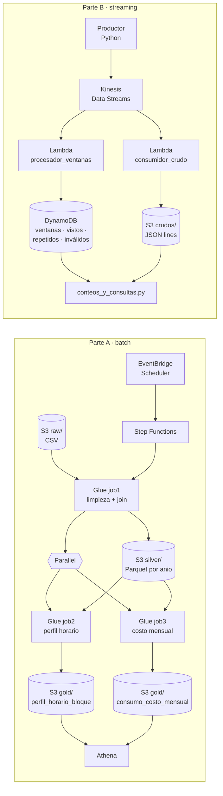

# Trabajo 2 — Pipeline batch y streaming en AWS

**Consumo de energía de subestaciones de un campus universitario**

| | |
|---|---|
| **Universidad** | Universidad EAFIT |
| **Programa** | Maestría en Ciencias de los Datos y Analítica |
| **Curso** | SI7006 — Almacenamiento y Procesamiento de Grandes Datos, 2026-2 |
| **Profesor** | Edwin Montoya (emontoya@eafit.edu.co) |
| **Equipo** | Marcela Londoño Leon, Isabela Osorio Botero, Zarith Isabella Restrepo Giraldo |
| **Video (YouTube)** | xxx |
| **Informe de reproducibilidad** | (INFORMETRABAJO2.md) |

---

## ¿De qué trata?

El proyecto integrador analiza el consumo horario de energía activa (kWh) de **120 medidores** conectados a
**9 bloques/subestaciones** de un campus, entre el 23-oct-2021 y el 22-oct-2026. El trabajo tiene dos partes:

- **Parte A (batch).** Un horario de **EventBridge Scheduler** inicia una máquina de estados de **Step Functions**.
  Un trabajo de **Glue (PySpark)** limpia 5,27 millones de lecturas, las une con el catálogo de medidores y escribe
  Parquet particionado por año. Después, dos trabajos de Glue corren **en paralelo** y responden dos preguntas de
  analítica, que se consultan con **Athena**.
- **Parte B (streaming).** Un productor publica eventos en **Kinesis Data Streams** durante más de 5 minutos, con
  repetidos e inválidos a propósito. Una **Lambda** calcula ventanas de 1 minuto (conteo y promedio de kWh por bloque)
  y las guarda en **DynamoDB**; otra Lambda guarda los eventos crudos en **S3**. Un script comprueba que los conteos cuadran.

## Arquitectura



## Preguntas de analítica y resultados

| # | Pregunta | Dónde se responde | Respuesta corta |
|---|---|---|---|
| A1 | ¿En qué hora y día de la semana se concentra la demanda de cada bloque? | Rama 1 → `gold/perfil_horario_bloque` → Athena | Casi todos los picos caen martes o miércoles (el bloque 03, jueves) y entre las 12:00 y las 18:00. El bloque 40 (canchas norte) es la excepción: su pico es a las 7:00. |
| A2 | ¿Cuánto consume y cuánto cuesta cada bloque por año, y cómo cambia? | Rama 2 → `gold/consumo_costo_mensual` → Athena | El bloque 40 es el mayor consumidor (≈23,1 GWh y ≈11.800 millones de COP en 2025). El bloque 18 baja ≈11 % en 2025 frente a 2024. |
| B | ¿Qué bloque tuvo el mayor consumo promedio por evento y cuál fue su ventana pico? | DynamoDB `ventanas_resultados` → `conteos_y_consultas.py` | _completar con la salida de su ejecución_ |

El detalle de las cifras y cómo obtenerlas está en el [informe]

## Estructura del repositorio

```
trabajo2-pipeline-batch-streaming/
├── README.md                          ← este archivo
├── INFORME_TRABAJO2.md                ← guía paso a paso para reproducir el proyecto
├── datos/
│   ├── consumo_sintetico_subestaciones.csv.gz   ← 5.274.657 lecturas (comprimido, ~44 MB)
│   └── medidores.csv                            ← 120 medidores (segundo conjunto, para el join)
├── parte_a_batch/
│   ├── glue/
│   │   ├── job1_limpieza_join.py      ← limpieza + join + Parquet particionado por anio
│   │   ├── job2_rama1_perfil_horario.py
│   │   └── job3_rama2_costo_mensual.py
│   ├── step_functions/
│   │   └── maquina_de_estados.json    ← definición ASL (Glue inicial + 2 ramas en paralelo)
│   └── athena/
│       └── athena_consultas.sql       ← tablas externas y consultas que responden A1 y A2
├── parte_b_streaming/
│   ├── productor.py                   ← PENDIENTE: agregar el productor del equipo
│   ├── lambda_procesador_ventanas.py  ← consumidor 1: valida, deduplica, ventanas → DynamoDB
│   ├── lambda_consumidor_crudo.py     ← consumidor 2: eventos tal como llegan → S3
│   └── conteos_y_consultas.py         ← cuadre de conteos + pregunta B
├── extras/
│   └── validacion_local_pyspark.py    ← (opcional) repite la Parte A en un PC, sin AWS
└── docs/img/                          ← capturas de consola usadas en el informe
```

## Inicio rápido

1. Clonar el repositorio y descomprimir los datos:
   ```bash
   git clone https://github.com/<usuario>/trabajo2-pipeline-batch-streaming.git
   cd trabajo2-pipeline-batch-streaming
   gunzip -k datos/consumo_sintetico_subestaciones.csv.gz
   ```
2. Seguir el [informe de reproducibilidad]: sección 5 para la Parte A y sección 6 para la Parte B.
   **Todos los recursos se crean a mano en la consola de AWS** (requisito del curso: sin CloudFormation, Terraform ni
   Serverless Framework).
3. (Opcional) Verificar las cifras de la Parte A sin AWS:
   ```bash
   pip install pyspark==3.5.3
   python3 extras/validacion_local_pyspark.py datos
   ```

## Tecnologías

AWS S3 · AWS Glue (PySpark) · AWS Step Functions · Amazon EventBridge Scheduler · Amazon Athena ·
Amazon Kinesis Data Streams · AWS Lambda (Python 3.12) · Amazon DynamoDB · Python 3 + boto3.

## Uso de inteligencia artificial

De acuerdo con la condición 7.5 del enunciado, el equipo declara de forma explícita en qué partes del trabajo usó IA. Todos los integrantes revisamos, entendemos y respondemos por todo el contenido, incluido el generado con IA.

Componente	¿Se usó IA?	Herramienta	Qué hizo la IA / qué hizo el equipo
Scripts de Glue (job1, job2, job3)	Sí  Claude (Anthropic) Revisión de los scripts y corrección de datos
Definición de la máquina de estados	NO	
Consultas de Athena	NO
Productor	NO
Lambdas (procesador de ventanas y consumidor crudo)	NO
Script de conteos y consulta	NO
Script de validación local (extras/)	Sí	Claude (Anthropic)	Generado por la IA para verificar las cifras de la Parte A sin AWS; el equipo lo ejecutó y comparó con los resultados de Glue/Athena.
README e informe de reproducibilidad	Sí	Claude (Anthropic)	Redactados por la IA a partir del código, los datos y el enunciado; el equipo revisó, corrigió y completó los datos propios (nombres, enlaces, resultados de la Parte B).
Análisis e interpretación de resultados	NO
